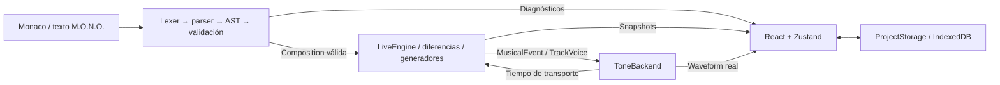

# Arquitectura M.O.N.O. Studio 0.1

## Referencia y preescuchas

El registro `src/language/reference.ts` concentra metadatos para el panel, la ayuda de Monaco, los presets y los límites compartidos con la validación. El generador visual compila el resultado antes de habilitar la inserción. La preescucha reutiliza el sintetizador y la biblioteca de samples del backend, pero crea una voz temporal independiente del transporte; la petición más reciente reemplaza la anterior y los nodos se liberan al terminar o cerrar el panel.

La aplicación es un cliente local. El código musical se transforma en datos validados; el núcleo conserva una composición activa y prepara cambios incrementales; el adaptador Tone.js produce audio; React presenta el estado. Ningún módulo ejecuta el código del usuario como JavaScript.



## Módulos y responsabilidades

| Ubicación | Responsabilidad |
| --- | --- |
| `src/language/lexer.ts` | Convierte caracteres en tokens con línea, columna y longitud. |
| `src/language/parser.ts`, `ast.ts` | Parser descendente con recuperación por línea; nodos globales, pistas y propiedades. |
| `src/language/validator.ts`, `index.ts` | Reglas musicales, límites y `compile()`; produce una `Composition` solo si no hay errores. |
| `src/core/types.ts` | Contratos compartidos `Composition`, `Track`, `PatternSpec`, `MusicalEvent`, `AudioBackend` y `TrackVoice`. |
| `src/core/diff.ts` | Clasifica altas, bajas, sustituciones, patrones y parámetros; identifica voces reutilizables. |
| `src/core/engine.ts` | Composición activa, una transacción pendiente, ciclo de vida, reloj por pasos, MUTE/SOLO y planificación. |
| `src/core/random.ts`, `generators.ts` | Flujos aleatorios por semilla/pista/instrumento y registro extensible de ocho algoritmos. |
| `src/audio/index.ts` | Transporte Tone, presets, voces, cadenas de efectos, automatización y disposición de nodos. |
| `src/audio/samples.ts` | Manifiesto local, carga y decodificación completas, límites de memoria y caché de kits. |
| `src/studio/` | Monaco, controles, consola, biblioteca, visualizador y estado de edición con Zustand. |
| `src/storage/projects.ts` | Contrato `ProjectStorage`, implementación IndexedDB y exportación de texto. |

El lenguaje importa únicamente tipos y valores musicales del núcleo. El núcleo no importa Tone.js, React ni el editor. `AudioBackend` permite sustituir la salida sin alterar el parser. El almacenamiento no conoce nodos ni el transporte.

## Representación musical

Una `Composition` contiene versión del lenguaje, BPM, escala, modo de escala, semilla y una lista de pistas. Los diagnósticos de advertencia no impiden crearla. Cada `Track` tiene un `id` estable, tipo `drums` o `synth`, nombre de kit/preset, parámetros independientes y datos de patrón o notas. El nombre de pista identifica su continuidad entre revisiones. Renombrarla equivale a eliminar una pista y añadir otra.

`PatternSpec` representa un patrón literal o una llamada generativa con argumentos e intervalo opcional. La generación produce 16 listas de golpes con velocidad y offset. El scheduler convierte cada golpe en un `MusicalEvent` que contiene pista, nota o instrumento, velocidad, desplazamiento temporal en segundos y duración. La API entrega al adaptador el tiempo exacto del callback de transporte; el adaptador añade el offset del evento.

`compile(source)` es una operación pura. No carga muestras, no abre audio, no cambia el motor. El resultado con diagnósticos nunca reemplaza automáticamente la composición. La interfaz hace comprobaciones de sintaxis al escribir, pero solo envía datos al motor con PLAY, RELOAD o Ctrl + Enter.

## Transacciones y reloj

`LiveEngine.submit()` toma una copia estable de la composición. Prepara voces únicamente para pistas nuevas o cambios de kit/preset. Las cargas asíncronas llevan una revisión; candidatos obsoletos se liberan. Antes de aceptar una preparación se vuelve a comparar con el estado activo, que pudo cambiar durante la carga.

Los parámetros continuos se automatizan sobre voces compatibles. Las diferencias estructurales se guardan en una única transacción y entran al paso cero del siguiente compás. Cuando se aplica, las pistas compatibles conservan su voz; una pista con patrón o notas diferentes reinicia su estado musical. Las pistas intactas conservan también el avance de notas y generadores. Consulta [LIVE_CODING.md](LIVE_CODING.md) para la semántica de cola, errores y STOP.

ToneBackend mantiene un único `Transport.scheduleRepeat(..., '16n', 0)`. El núcleo cuenta semicorcheas y compases. No crea un loop por pista ni utiliza `setInterval` como reloj musical. STOP elimina ese callback y reinicia la posición. PLAY comienza con el mismo estado de semilla desde el inicio.

## Grafo y recursos de audio

```text
Synth / pool de samples
  → filtro low-pass
  → feedback delay
  → reverb
  → ganancia de pista
  → puerta MUTE/SOLO y retirada
  → ganancia maestra
  → limitador
  → salida + analizador de onda
```

Cada pista tiene su propia cadena. Los cambios de cutoff, Q, mezcla de efectos y volumen utilizan rampas de 35 ms. MUTE y las retiradas usan un fade de 18 ms. El BPM cambia sobre el transporte compartido con una rampa breve. Un cambio de preset prepara su nueva cadena antes de retirar la anterior en el límite musical.

Los sintetizadores usan envolventes y osciladores diferenciados: seno para `sub`, sierra para `analog`, modulación de frecuencia para `fm`, sierras ensanchadas y ataque lento para `pad`. Su polifonía se limita a ocho voces. Las baterías usan `Tone.Player`, con cuatro reproductores por instrumento y buffers de audio decodificados. No existen osciladores de batería.

La carga de samples comprueba el manifiesto, rutas locales, tamaño, duración, canales y presupuesto de audio decodificado. Se carga el kit completo antes de crear una voz utilizable. Los errores de carga no se guardan en caché y pueden reintentarse. La caché LRU conserva cuatro kits; las voces existentes mantienen referencias a sus buffers aunque un kit salga de la caché.

Los fades se programan en el reloj de audio. Un temporizador de JavaScript se usa solamente para liberar nodos ya silenciados, nunca para disparar música. STOP libera voces; cerrar el motor libera además analizador, buses, efectos, cachés y cargas pendientes. Las operaciones de disposición son idempotentes.

## Interfaz y persistencia

Monaco carga su worker local mediante Vite y registra un lenguaje, tema, autocompletado y marcadores propios. Zustand conserva borrador, nombre, ajustes, diagnósticos y una consola acotada a 200 entradas. `useSyncExternalStore` observa los snapshots del motor. El canvas consulta el analizador real como máximo 20 veces por segundo y omite el dibujo con la pestaña oculta. La visualización no planifica audio y puede reflejar la anticipación del transporte.

`ProjectStorage` define `list`, `get`, `save` y `remove`. `IndexedDbProjects` guarda proyectos por ID con código, nombre, versión, volumen maestro, referencias a kits y fecha. La UI permite guardar y recuperar. Importar/exportar `.mono` opera sobre texto; no empaqueta WAV ni configuraciones de proyecto. El almacenamiento es por navegador y origen local.

## Extensión y límites actuales

Un nuevo generador se registra en el núcleo y añade sus reglas de argumentos a las opciones del compilador; no necesita alterar el parser. Un futuro backend MIDI puede implementar `AudioBackend` y traducir `MusicalEvent`. Un futuro servicio de proyectos puede implementar `ProjectStorage`. IA y Supabase no están implementados ni son dependencias de ejecución.

La versión inicial mantiene 4/4, 16 pasos, tres instrumentos de batería en el lenguaje y escalas mayores/menores naturales. No incluye grabación, edición de samples, polimetría ni cambios de gramática en ejecución. La reproducibilidad garantiza secuencias de eventos con la misma semilla, no bytes de audio idénticos entre navegadores. Las pruebas de audio con dobles comprueban contratos y limpieza; la escucha y la estabilidad prolongada requieren comprobación en el navegador y dispositivo de destino.
